# Default views for mur-voir

Research for the 2026-11-17 track day, when the team couldn't find the values it needed in
mur-voir and went back to car.melbourneuniracing.com. This proposes one default layout of nine
tabs, using only tab types mur-voir already has. Nothing in `src/` has changed.

Decided so far: Lite users get it from a File > Default layouts menu and from a `?layout=` link,
and loading it adds its tabs rather than replacing the open ones. The same change fixes gaps 1 to
5 below.

Sources read, all on their default branches after `git fetch`:

- mur-embedded `origin/master` at `453c7b5`. It has no `main` branch.
- mur-msgs `origin/main` at `7f3abc5`. Wireless-telem's `uv.lock` pins the same commit, so the
  car's cellular publisher sends these DBCs.
- Wireless-telem `origin/main` at `66afce0`, for the cellular publisher, bus mapping and the
  car Pi.
- mur-voir `origin/mur-voir/main` at `dbb583ab`. The worktree branch had been cut from upstream
  AdvantageScope `main`, so I reset it, while it was still empty, onto the fork's main.

## What car.melbourneuniracing.com is

The name resolves to `100.64.0.3`. That is `mur-wireless-telemetry`, the car's Pi, on the
tailnet. The Pi was offline (last seen 6 h ago) and the page timed out, so I couldn't load it.
No repo in `~/code` or in the GitHub org contains the hostname.

The only web UI in our repos that runs on that Pi is mur-embedded's `tools/bench/can_live.py`.
The shakedown runsheet (`docs/shakedown-runsheet.md` section 2) starts it on the Pi with
`-i can1 -i can0`. It serves `mur_dash.html` with the presets in `tools/bench/mur_can.py`
(`PRESETS`, lines 58 to 268):

| can_live view     | Charts                                                                                                                                                        | Tiles                                                                                                                                                         |
| ----------------- | ------------------------------------------------------------------------------------------------------------------------------------------------------------- | ------------------------------------------------------------------------------------------------------------------------------------------------------------- |
| Shakedown         | motor rpm (inverter and ECU), front and rear wheel km/h, inverter state, car state, inverter faults, node faults                                              | motor rpm, wheel speeds, VSM, inverter state, enable, lockout, ECU state, TS active, POST and run fault words, TTCS/pedal/dash faults, IMD, dash-to-ECU stale |
| Spin / dyno       | rpm, torque (ECU request, inverter command, feedback), DC and mechanical power, efficiency map, DC bus V and A, phase currents, pedals, inverter temps, state |                                                                                                                                                               |
| HV up / precharge | AIR-/AIR+/TS active, DC bus vs pack voltage, ECU state, VSM                                                                                                   |                                                                                                                                                               |
| Battery           | pack voltage, cell min/max, TTCS DCL/CCL, DC current, SoC                                                                                                     |                                                                                                                                                               |
| Faults            | TTCS fault bits, ECU state, inverter fault bytes 0 to 7, AIRs                                                                                                 |                                                                                                                                                               |
| Charging (cart)   | charger command vs pack, current, cells, charger state                                                                                                        |                                                                                                                                                               |
| Vehicle dynamics  | shockpots, steering, INS speed, wheel speeds, SBG accel and gyro (front and rear), INS solution                                                               |                                                                                                                                                               |

It also keeps an event list (state changes, fault bits set and cleared, markers), peak values
since "Reset peaks", a stopwatch, and decoded inverter fault names.

The user confirmed on 2026-11-17 that car.melbourneuniracing.com is `can_live.py`.

## How a Lite user gets a layout today

Hosted Lite (`src/main/lite/main.ts`) has one way in: File > Import Layout… opens a file picker
for a `.json` and sends its first hub state as `restore-state`, which replaces every tab. There
are no bundled layouts, no URL parameter, and no presets in the "+" tab menu. A Lite user needs a
layout file on their machine first, which fails the "one or two clicks, no file import" rule. Lite
keeps the last state in `localStorage`, so a layout survives a reload once it has been loaded.

Ways to deliver the defaults, all loading the same JSON files shipped with the build:

| Option                                                         | Clicks in Lite | Notes                                                                                                                                         |
| -------------------------------------------------------------- | -------------- | --------------------------------------------------------------------------------------------------------------------------------------------- |
| A. File > Default layouts > _view_                             | 2              | Same menu on desktop. Should add the view's tabs rather than replace the open ones.                                                           |
| B. Link: `https://voir.melbourneuniracing.com/?layout=default` | 1              | Bookmark it, or pin the links in Slack. Lite reads the parameter on load, then removes it from the URL so a reload doesn't reload the layout. |
| C. Presets in the "+" new-tab menu                             | 2              | Doesn't fit a nine-tab layout.                                                                                                                |

Decided: A and B, both adding tabs. The link would be `?layout=default`.

## How one layout works on cellular, MF4 and the mock

Every field in these layouts uses its live cellular path and records its DBC signal name
(`dbcSignal` in the source list item). When the path is missing from the open log,
`SourceList.refresh()` (`src/hub/SourceList.ts:391`) re-points the field at the one field whose
metadata has the same `dbcSignal`. That fallback already exists (PR #9).

- Cellular paths are `vehicles/mur27/can<bus>/<message>/<signal>` in lower case
  (Wireless-telem `services/telem/src/telem/cellular.py:129`). The bus number is the Pi's logical
  bus from `config/telem.toml`, not the interface name. `can0` is Control/Tractive (inverter,
  ENNOID, TTCS, pedals), which is physical `can1`. `can1` is Telemetry (dash, ECU dash frames, PDU,
  SBG), which is physical `can0`. mur-embedded's runsheet names the interfaces the other way round.
- MF4 runs decode through the bundled DBCs to `<NODE>/<Signal>` keys such as
  `INVERTER/INV_MotorSpeedRPM` (`src/hub/dataSources/can/CANKeys.ts`), and each key's metadata
  carries `dbcSignal`. So the fallback finds them. Units differ: cellular sends SI (K, rad/s, Pa,
  m/s) and MF4 keeps DBC units (°C, rpm, psi, km/h). Line graph axes in these layouts set a unit
  target (`leftUnitConversion.autoTarget`), and the screenshots show rad/s plotted as rpm.
- The mock backend uses semantic paths (`powertrain/inverter/motor_speed`), but 46 of its signals
  declare DBC provenance, so the fallback re-points those. The screenshots below prove that path:
  tiles on the mock's paths were re-pointed from `can0/...` paths in the layout file.

Gaps found while testing this. Numbers 1 to 5 are in scope for the change:

1. Trackside limits are keyed by `logKey` (`TracksideController.ts:57`). When the fallback
   re-points a field, its limit stays on the old path and stops alerting. They should be keyed
   by `dbcSignal` when the field has one. This applies to MF4 runs and the mock.
2. Sentinel values have no handling. `ECU_AccuTempMax` sends 0x7FFF (3276.7 °C) when invalid,
   `ECU_MotorTemp` sends 215, speeds 0xFFFF (6553.4). A Trackside limit of 60 °C would alarm on
   "no reading". can_live keeps a table of these (`INVALID` in `mur_can.py`), and the DBC
   comments state each one ("Raw 0x7FFF = invalid").
3. mur-voir's bundled DBCs are mur-msgs `e6d2f48` from 2026-10-31
   (`src/hub/dataSources/can/dbc/SOURCE.txt`). They lack `ECU_DashData3` and `Dashboard_Lap`,
   so an MF4 run shows those frames as `CAN/Unknown/0x242` and `0x206`. Re-copy them from `7f3abc5`.
4. Trackside tile labels are the last path segment (`ecu_accutempmax`), and the cellular
   descriptor's `display.label` is ignored. Tiles should show the DBC name or a label stored in the
   layout.
5. A Trackside tab fits eight tiles at 1600×1000 in two columns. The 21-tile Track day tab
   scrolls. It needs a denser grid, or a tile-size option saved in the layout.
6. Fault bitfields show as hex (`0x1000`) because the DBC comments for `HB_TTCS_FaultBits`,
   `ECU_FaultFlags` and `PEDAL_BSEStatus` list no bits. `classifyDBCFault` reads `bit N: name` from
   comments, so adding the TTCS bits from mur-embedded `firmware/lib/ttcs/include/ttcs_faults.h`
   to the mur-msgs comment would name them. Inverter fault bytes need the Cascadia POST/RUN names
   that can_live has (`INV_POST_FAULTS`, `INV_RUN_FAULTS`).
7. Over cellular, a Trackside tile shows motor speed in rad/s, because only graph axes have a
   unit target. Tiles need the same, or the profile should show the DBC unit when the descriptor
   names one.
8. The Track and laps tab fills a gear ratio of 4.333 (39/9). The team changed the final drive to
   4.777 on 2026-11-01 (`mur_can.py` `MOTOR_RPM_PER_REAR_WHEEL_RPM`, `dash_speed.h`).

## The default layout

One layout, `layouts/default.json`, made by `build-layouts.mjs`. `layouts/signal-paths.json`
lists every path it uses. It has nine tabs and uses only tab types mur-voir already has. Each
field is placed as if someone had dragged it in, and shows in the tab's list where it can be
removed or reordered. Values that the earlier per-view drafts repeated now appear once: the
headline numbers on "Track day", the fault words on "Faults", and history on named graphs. The
Driver Inputs tab is dropped, because "Pedals" and the steering on "Car" cover it.

Limits come from firmware only: TTCS `firmware/apps/ttcs/src/main.c`, `gs_batt_cal` (cells 2.5
to 4.2 V, pack 270 to 453.6 V, battery 60 °C).

| #   | Tab (type)                         | Fields                                                                                                                                                                                                       | Why at the track                                                                                     | Evidence                                                                 |
| --- | ---------------------------------- | ------------------------------------------------------------------------------------------------------------------------------------------------------------------------------------------------------------ | ---------------------------------------------------------------------------------------------------- | ------------------------------------------------------------------------ |
| 1   | Track day (Trackside)              | 21 tiles, below                                                                                                                                                                                              | Is the car ready, what mode and torque limit, how much battery and thermal margin, is anything wrong | dash screen pages (`docs/dash-modes.md`), can_live Shakedown and Battery |
| 2   | Faults (Trackside)                 | AIR- and AIR+, inverter lockout, TTCS/pedal/dash/rear fault bits, ECU fault flags, inverter fault bytes 0 to 7                                                                                               | Why the car won't go ready to drive, or why it dropped out                                           | can_live Shakedown and Faults                                            |
| 3   | States (Line Graph, discrete row)  | ECU state, TS active, AIR- and AIR+, VSM, inverter enabled, IMD, ABPC                                                                                                                                        | When each state changed; stands in for can_live's event list                                         | can_live events (`_WATCH`)                                               |
| 4   | HV voltage (Line Graph)            | left: pack, inverter DC bus. right: cell min, cell max (V)                                                                                                                                                   | Precharge, sag under load, cell spread                                                               | can_live HV and Battery                                                  |
| 5   | Accu temp and current (Line Graph) | left: accu max, accu min, TTCS battery high temp (°C). right: inverter DC current, TTCS HV current, DCL, CCL (A)                                                                                             | Heat build-up against 60 °C, TTCS cutting the current limit                                          | can_live Battery, TTCS limits                                            |
| 6   | Motor and torque (Line Graph)      | left: motor speed (rpm). right: ECU torque request, inverter command, inverter feedback (Nm). discrete: BMS limiting torque                                                                                  | Does the car make the torque it asks for                                                             | can_live Spin                                                            |
| 7   | Drive temps (Line Graph)           | left: ECU motor and inverter temps, IGBT modules A to C, gate driver, control board, coolant, hot spot, radiator in and out (°C). right: fan duties (%). discrete: pump, coolant limiting, hot-spot limiting | Heat towards the inverter's own derates; no firmware sets a motor limit                              | dash Endurance page, can_live Spin                                       |
| 8   | Pedals (Line Graph)                | left: pedal 1 and 2 (%). right: brake front and rear (psi). discrete: brake torque cut                                                                                                                       | What the driver did; APPS agreement                                                                  | dash Skidpad page                                                        |
| 9   | Car (Car Dynamics)                 | steering, front wheel speeds, yaw, longitudinal and lateral accel, four shockpots                                                                                                                            | Are the dynamics sensors alive                                                                       | can_live dynamics                                                        |

Track day tiles, with cellular paths under `/vehicles/mur27/`:

| Tile                   | Path                                              | Limit                                                                |
| ---------------------- | ------------------------------------------------- | -------------------------------------------------------------------- |
| ECU_ECUState           | `can0/ecu_status/ecu_ecustate`                    | Fault label is critical (DBC enum)                                   |
| ECU_StartStage         | `can1/ecu_dashdata3/ecu_startstage`               |                                                                      |
| ECU_TSActive           | `can0/ecu_status/ecu_tsactive`                    |                                                                      |
| INV_VSMState           | `can0/inv_internalstates/inv_vsmstate`            |                                                                      |
| ECU_DashMode           | `can1/ecu_dashdata3/ecu_dashmode`                 |                                                                      |
| ECU_TorqueSet          | `can1/ecu_dashdata3/ecu_torqueset`                |                                                                      |
| ECU_AccuSOC            | `can1/ecu_dashdata/ecu_accusoc`                   |                                                                      |
| ECU_AccuTempMax        | `can1/ecu_dashdata/ecu_accutempmax`               | high 60 °C                                                           |
| ENNOID_CellVoltageMin  | `can0/ennoid_summary/ennoid_cellvoltagemin`       | low 2.5 V                                                            |
| ENNOID_CellVoltageMax  | `can0/ennoid_summary/ennoid_cellvoltagemax`       | high 4.2 V                                                           |
| ENNOID_PackVoltage     | `can0/ennoid_vtot/ennoid_packvoltage`             | 270 to 453.6 V                                                       |
| TTCS_DCL               | `can0/ttcs_limits/ttcs_dcl`                       |                                                                      |
| ECU_MotorTemp          | `can1/ecu_dashdata2/ecu_motortemp`                |                                                                      |
| ECU_InverterTemp       | `can1/ecu_dashdata2/ecu_invertertemp`             |                                                                      |
| TELEM_LVBatteryVoltage | `can1/telemetry_lvbattery/telem_lvbatteryvoltage` |                                                                      |
| DASH_SpeedCar          | `can1/dashboard_speed/dash_speedcar`              |                                                                      |
| DASH_LastLap           | `can1/dashboard_lap/dash_lastlap`                 |                                                                      |
| DASH_BestLap           | `can1/dashboard_lap/dash_bestlap`                 |                                                                      |
| TTCS_IMDState          | `can0/ttcs_status/ttcs_imdstate`                  | Fault and Warning labels                                             |
| ECU_ABPCActive         | `can1/ecu_dashdata3/ecu_abpcactive`               |                                                                      |
| ECU_DashInputsStale    | `can0/ecu_status/ecu_dashinputsstale`             | can_live: "the first thing to know when the RTD button does nothing" |

Paths for the other tabs: Faults uses `can0/ttcs_status/ttcs_sdcstatus1|2`,
`can0/inv_internalstates/inv_inverterenablelockout`, `can0/mur_hb_ttcs/hb_ttcs_faultbits`,
`can0/mur_hb_pedalbox/hb_pedal_faultbits`, `can1/mur_hb_dash/hb_dash_faultbits`,
`can0/mur_hb_rear/hb_rear_faultbits`, `can0/ecu_status/ecu_faultflags` and
`can0/inv_faultcodes/inv_faultbyte0..7`. The graphs use `can0/inv_motorposition/inv_motorspeedrpm`,
`can0/ecu_control/ecu_torquerequest`, `can0/inv_torquetimer/...`, `can0/inv_temperatures1|2|3_torque/...`,
`can0/rear_thermal/...`, `can1/pdu_status/...`, `can0/pedal_status/...` (100 Hz on the car, 50 Hz
over cellular) and `can0/ttcs_limits/...`. Car uses `can1/dashboard_dynamics/...`,
`can1/dashboard_speed/dash_speedfl|fr`, `can1/sbg_front_gyro/sbg_front_gyroz`,
`can1/sbg_front_accel/...` and `can0/rear_dynamics/...`. The full list is in `signal-paths.json`.

On "Car", longitudinal accel is `SBG_FRONT_AccelY` with Invert and lateral is `SBG_FRONT_AccelX`,
because the SBG body frame is X right, Y back, Z down. Steering and shockpots still carry pin
millivolts until the cals exist (`DASH_BENCH_RAW_MV = 1` in the dash app).

Left out: charging only matters on the cart (the cart view in `can_live.py`, charger fields on
`can0/charger_status/...`), and lap timing already has the Track and laps tab.

## What the car site shows that mur-voir can't get over cellular today

Every raw CAN signal can_live charts is in the cellular catalogue: the publisher sends every frame
in both buses' DBCs (`all_frames = true`, up to 50 Hz). What is missing is what can_live computes:

| can_live value                                                   | Why it's missing                                                                                                                                    | Possible fix                                                                          |
| ---------------------------------------------------------------- | --------------------------------------------------------------------------------------------------------------------------------------------------- | ------------------------------------------------------------------------------------- |
| `DC_Power_kW`, `Mech_Power_kW`                                   | derived (V×A, torque×rpm)                                                                                                                           | computed fields in mur-voir, or the publisher sends them                              |
| `Motor_Eff_Pct`                                                  | EMRAX 208 map lookup (`emrax208.py`)                                                                                                                | port the table                                                                        |
| `INV_PostFaults` / `INV_RunFaults` with names                    | two 32-bit words combined from bytes 0 to 3 and 4 to 7, named from the Cascadia manual                                                              | decode table in mur-voir, or bit names in the DBC comment                             |
| Fault names for TTCS, pedal, dash, charger bits                  | can_live has per-node name tables; the DBC comments have none                                                                                       | add `bit N: name` to the mur-msgs comments                                            |
| `Wheel_FL/FR/Rear_kmh`                                           | derived from wheel rpm                                                                                                                              | use `DASH_SpeedFL/FR/Rear`, which the dash node computes the same way (4.777, 0.0766) |
| `SBG_FRONT/REAR_Speed_kmh`                                       | hypot of EKF velocity                                                                                                                               | derived field, or `DASH_SpeedCar`                                                     |
| Event list, peaks since reset, markers, stopwatch, run splitting | page features, not signals                                                                                                                          | out of scope here                                                                     |
| Per-cell voltages and temperatures                               | `ENNOID_VCell` and `ENNOID_Temps` are multiplexed by `CellIndex`/`TempIndex`; cellular sends `CellV0..2` by name and each frame overwrites the last | publisher demux to one path per cell, if wanted                                       |
| Signals during a cellular dropout                                | backend keeps 5 min of history, the car's R980 took 2 min 50 s to come up today                                                                     | the run archive browser (other thread) covers MF4                                     |

The radio link (`[[live]]` in `telem.toml`) only carries the Shakedown frames at 1 to 3 Hz, so
none of the accumulator, temperature or dash-mode values reach a radio-only viewer.

## Screenshots

`npm run screenshot -- --mock`, with the layout loaded through `restore-state` and 12 s for the
mock car to drive. The mock lacks the ECU dash frames, the heartbeat fault bits, the inverter fault
bytes and module temperatures, the TTCS AIR states and limits, `Dashboard_Lap`,
`Telemetry_LVBattery` and `Rear_Thermal`. Those fields appear struck through in the tab's list and
as "—" on tiles. Adding them to `tools/mock-backend/src/signals.ts` is a separate change. Fields
that resolved on the mock, from the `--eval` report:

| Tab                   | Resolved | Missing on mock |
| --------------------- | -------- | --------------- |
| Track day             | 8        | 13              |
| Faults                | 0        | 16              |
| States                | 5        | 3               |
| HV voltage            | 4        | 0               |
| Accu temp and current | 3        | 4               |
| Motor and torque      | 3        | 2               |
| Drive temps           | 2        | 14              |
| Pedals                | 3        | 2               |
| Car                   | 10       | 0               |

Two things the screenshots show beyond the gaps above. A graph with only discrete fields
("States") still draws an empty -1 to 1 plot above the stripes. The mock's `accel_x` is
longitudinal, so with the real SBG mapping its g-dot sits sideways on "Car".

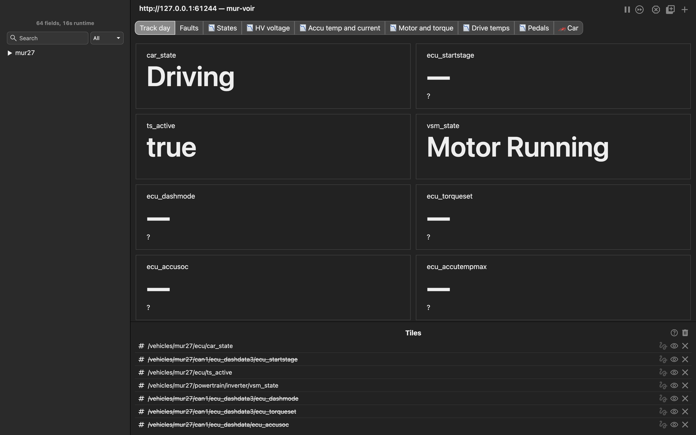
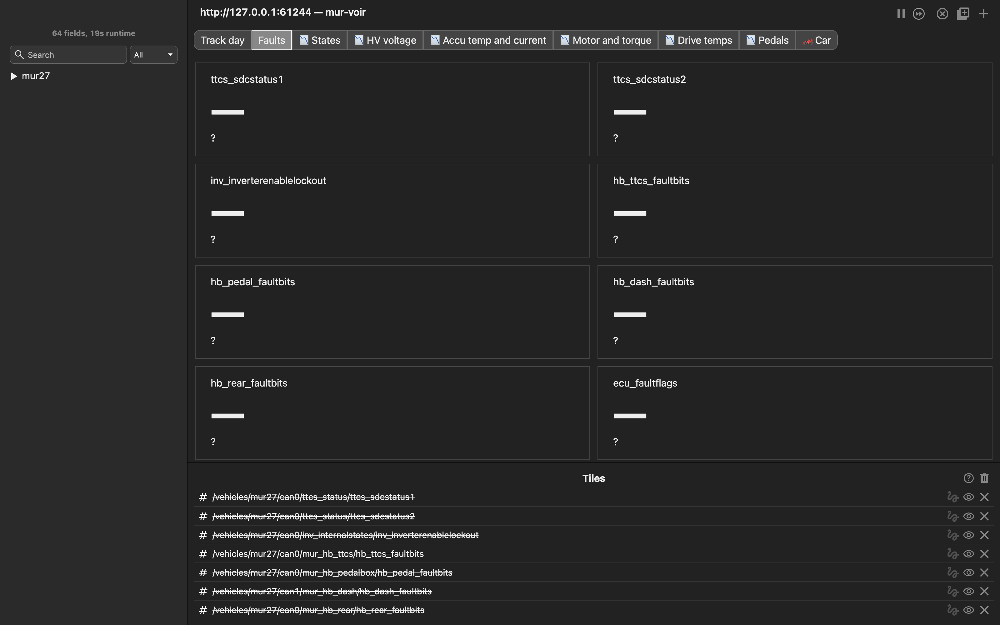
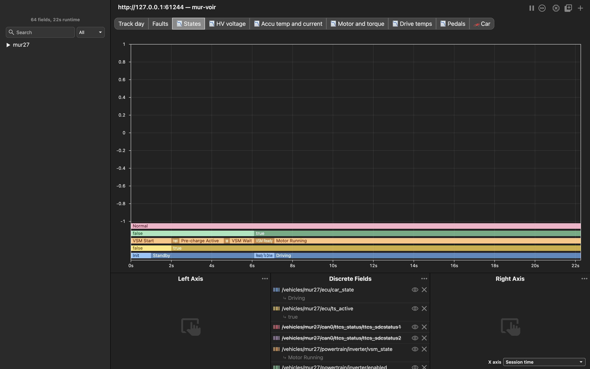
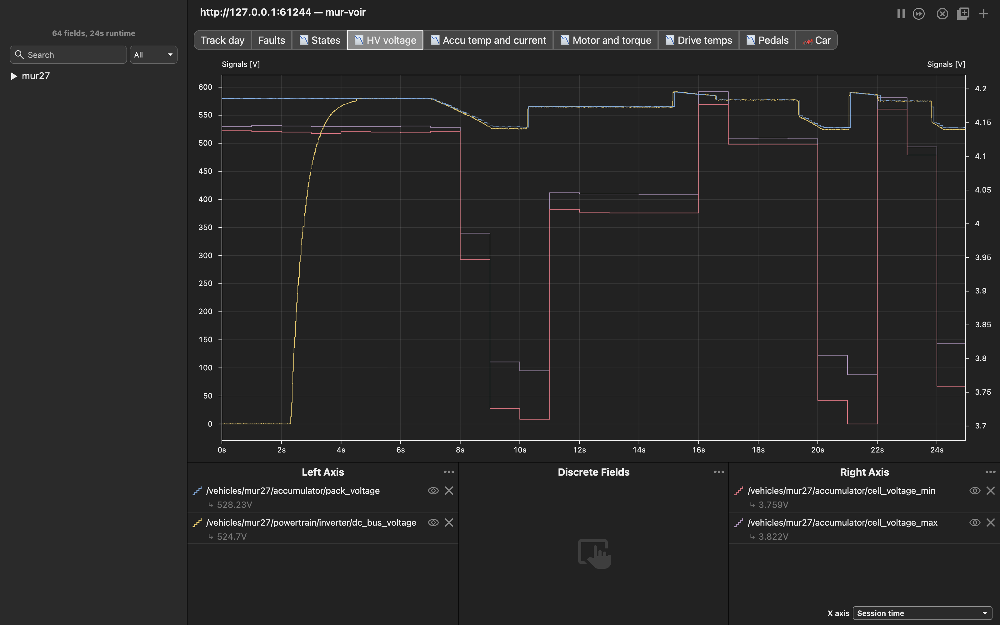
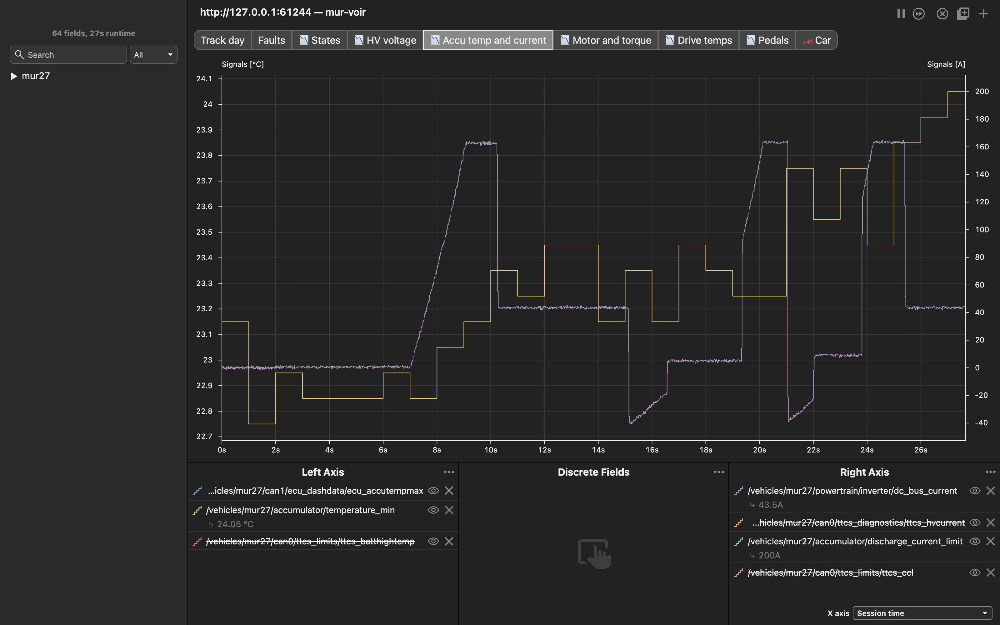
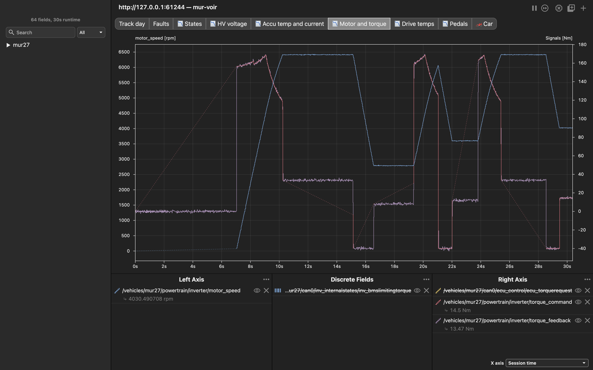
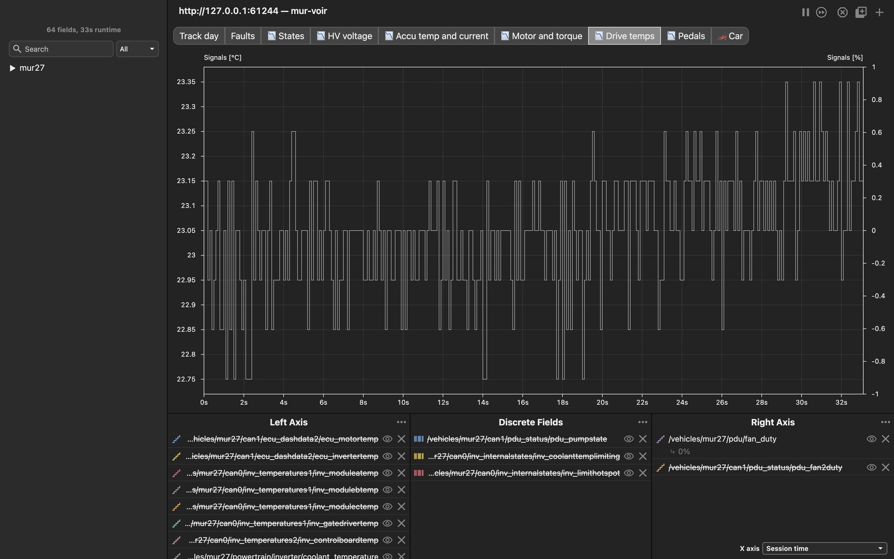
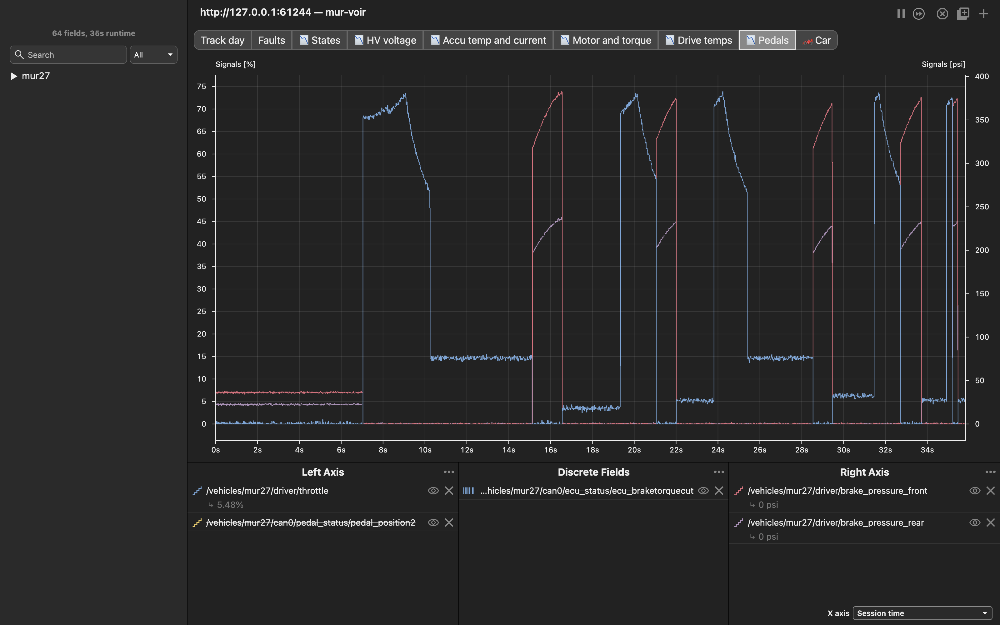
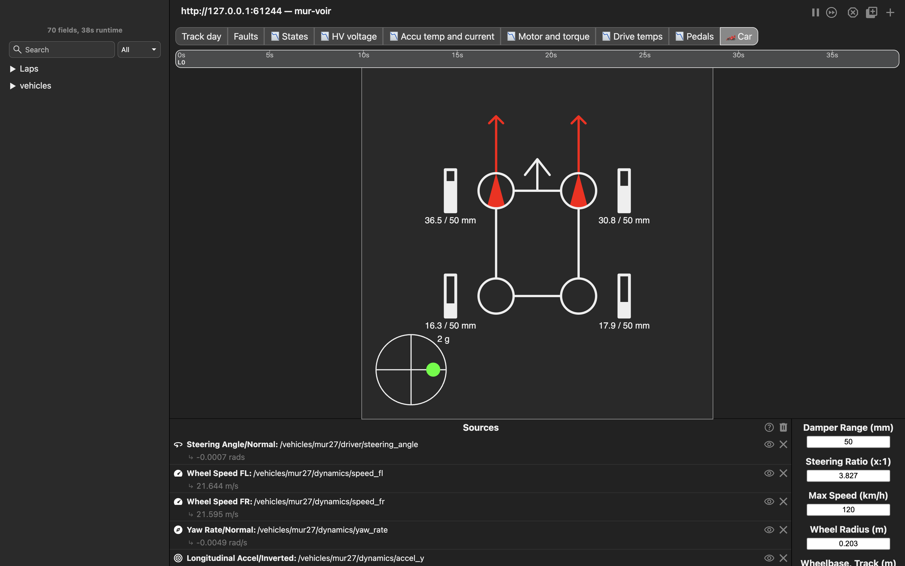

## Commands run

```sh
ln -s /Users/jasper/code/telemetry-dashboard/app/node_modules node_modules
git fetch origin && git reset --hard origin/mur-voir/main   # empty branch, wrong base
node getLicenses.mjs        # src/licenses.json is a gitignored postinstall output; compile failed without it
npm run screenshot -- --mock --layout trackside --name baseline --eval 'return window.tabs.saveState()'
node research/default-views/build-layouts.mjs
# via a scratch script, first per view, then for the single default layout:
npm run screenshot -- --no-build --mock --theme dark --size 1600x1000 \
  --out research/default-views/screenshots --name default \
  --eval "window.messagePort.onmessage({data:{name:'restore-state',data:<hub state>}}); await new Promise(r=>setTimeout(r,12000));" \
  --eval "<report of resolved and missing fields>" --tab 0 ... --tab 8 --wait 2500
npm run format
```

No run printed a `[headless] suppressed` line or a renderer error. I did not run
`npm run lite-smoke`. The Lite layout path above comes from reading `src/main/lite/main.ts`.

## Built (2026-11-17)

The user chose the nine tabs as listed, the menu and the link, adding tabs, first-open loading in
Lite, and fixes 1 to 5.

- `src/shared/layouts/default.json` is the layout, generated by `node tools/default-layout.mjs`.
  `src/shared/DefaultLayouts.ts` lists it.
- File > Add Track Day Layout, in Lite and on desktop, sends `add-default-layout` to the
  hub. `Tabs.appendState` adds the tabs after the open ones with fresh controller UUIDs and skips
  the layout's Documentation tab.
- Lite opens with the layout when the browser has no saved layout. `?layout=default` adds it and
  then removes the parameter from the URL. On first open the link doesn't add a second copy.
- Trackside limits move with a tile when the DBC fallback re-points it (`SourceList.onFieldRemapped`,
  `TracksideController.moveLimits`).
- Cellular samples equal to a DBC sentinel are stored as NaN (`src/hub/dataSources/mur/LiveSentinels.ts`),
  converted to the SI unit the Pi sends. MF4 decoding already did this. Trackside shows NaN as
  "no reading" and never alarms on it.
- Bundled DBCs are mur-msgs `7f3abc5`.
- Tiles are named by DBC signal (then the layout's saved name, then the source label), and the
  grid fits 21 tiles at 1600×1000.

Verified with `npm test` (344 pass, 7 new in `test/default-layout.test.ts`), `npm run lite-smoke`
(extended for first open, the menu and the link; it now waits on a default-layout field instead
of `vehicle_speed`), `npm run check-format`, and
`npm run screenshot -- --mock --eval "<add-default-layout>" --tab 3 --tab 4 --tab 7`.

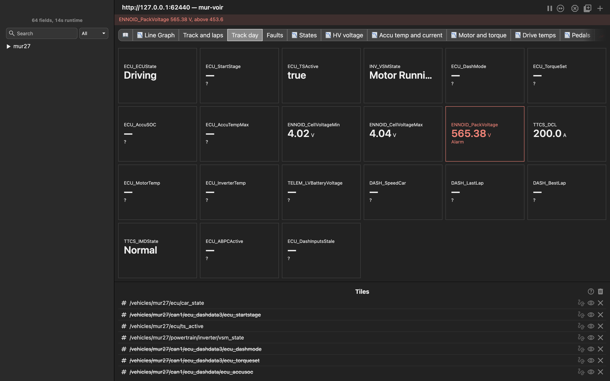
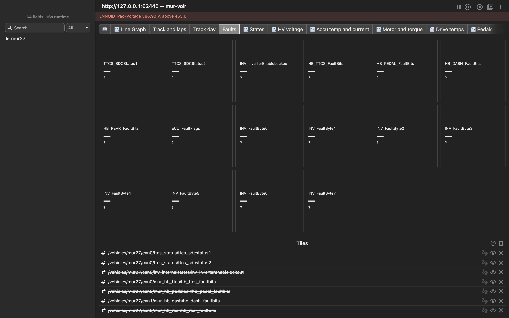
